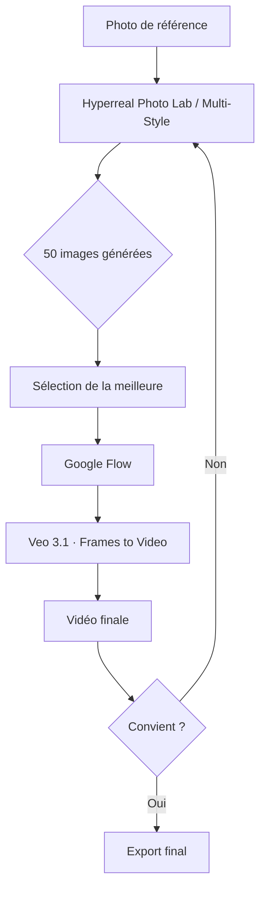

# 🎬 Ai Movie Maker Tools

> **Un laboratoire d'images clés pour la création vidéo assistée par IA.**
> Conçu pour les réalisateurs, les créateurs de contenu et les utilisateurs de **Google Flow**.
> Propulsé par l'API **Agnès AI**.

[](https://labs.google/flow)
[](https://platform.agnes-ai.com)
[]()
[]()

---

## 📖 Sommaire

- [Introduction](#-introduction)
- [Pourquoi ce projet ?](#-pourquoi-ce-projet-)
- [Pourquoi Google Flow ?](#-pourquoi-google-flow-)
- [Pourquoi Agnès AI ?](#-pourquoi-agnès-ai-)
- [Les deux applications](#-les-deux-applications)
- [Installation](#-installation)
- [Workflow typique avec Google Flow](#-workflow-typique-avec-google-flow)
- [Explication du code source](#-explication-du-code-source)
- [Comment améliorer le code](#-comment-améliorer-le-code)
- [Comment améliorer l'expérience utilisateur](#-comment-améliorer-lexpérience-utilisateur)
- [20 idées de transformation du projet](#-20-idées-de-transformation-du-projet)
- [Contribuer](#-contribuer)
- [Licence](#-licence)

---

## 🌟 Introduction

**Ai Movie Maker Tools** est un ensemble de deux applications HTML autonomes qui génèrent des **images clés** — ces fameuses *first frames* — à partir d'une ou plusieurs images de référence.

Ces images sont **prêtes à être utilisées dans Google Flow** comme point de départ pour la génération vidéo avec **Veo 3.1**.

Chaque application est un **fichier HTML unique**, sans dépendance externe, sans installation, sans inscription. Vous le téléchargez, vous l'ouvrez dans votre navigateur, vous collez votre clé API Agnès, et vous générez.

> 💡 **Pas de serveur, pas de backend, pas de build. Juste un fichier.**

### Mots-clés du projet

`#GoogleFlow` `#Veo3` `#AgnèsAI` `#ImageGeneration` `#FirstFrame` `#KeyFrame`
`#Photorealism` `#MultiStyle` `#CinemaAI` `#Storyboard` `#Previsualisation`
`#WebApp` `#HTML5` `#NoBackend` `#API` `#AIAgents` `#CreativeDirector`
`#Filmmaking` `#VideoPrompt` `#Hyperrealism` `#MultiKeyRotation`

---

## 🎯 Pourquoi ce projet ?

Google Flow permet de générer des vidéos à partir de :

- Un **texte** décrivant la scène.
- Une **image de référence**.
- Une **première image et une dernière image** (mode *Frames to Video*).

**Le problème :** trouver ou générer ces images de départ est un travail fastidieux, chronophage et souvent frustrant. Il faut :

- Connaître les bons prompts.
- Maîtriser les styles visuels (photographie, animation, BD…).
- Assurer une cohérence entre toutes les images du projet.
- Produire plusieurs variantes pour choisir la meilleure.

**La solution :** ces deux outils automatisent tout ce processus. En quelques minutes, vous obtenez des dizaines d'images clés cohérentes, stylistiquement riches, prêtes à être injectées dans Google Flow.

### Ce que vous gagnez

| Avant | Après |
|---|---|
| Chercher une image par hasard | Générer 50 images en 5 minutes |
| Prompts approximatifs | Prompts précis conçus par l'IA |
| Style visuel incertain | 21 styles à disposition |
| Une seule tentative | Rotation automatique de clés API |
| Incohérence entre images | Cohérence garantie par analyse |
| Perte des sessions | Sauvegarde intelligente |

---

## 🚀 Pourquoi Google Flow ?

**Google Flow** est l'interface de création vidéo assistée par IA de Google. Elle s'appuie sur **Veo 3.1**, un modèle vidéo génératif capable de :

- Générer une vidéo à partir d'un simple texte.
- Étendre une image existante en vidéo.
- **Interpoler entre deux images** (mode *Frames to Video*).
- Respecter un style visuel donné.
- Synchroniser des dialogues et des effets sonores.

### Le workflow *Frames to Video*

1. Vous fournissez une **image de départ** (*first frame*).
2. Vous fournissez éventuellement une **image de fin** (*last frame*).
3. Veo 3.1 génère la **transition** entre les deux, ou anime la première.

**C'est précisément sur cette première image que notre projet se concentre.** Elle est cruciale : c'est elle qui définit le ton, le style, la composition, l'ambiance. Une bonne première image = une bonne vidéo.

### Où nos outils s'insèrent

```
[ Photo de référence ]
        ↓
[ Ai Movie Maker Tools ]   ← génère ~50 images clés
        ↓
[ Sélection de la meilleure ]
        ↓
[ Google Flow ]            ← génère la vidéo
        ↓
[ Vidéo finale ]
```

`#GoogleFlow` `#Veo31` `#FirstFrame` `#FramesToVideo`

---

## 💜 Pourquoi Agnès AI ?

L'API **Agnès AI** est au cœur de ces outils. Voici pourquoi elle est prodigieuse pour assister les réalisateurs :

### 1. Génération d'images de haute qualité

Le modèle `agnes-image-2.1-flash` produit des images en résolution `1024x1792` (portrait 9:16), parfaites pour :

- Un rendu photoréaliste saisissant.
- Une diversité stylistique infinie (via le prompt).
- Une cohérence visuelle inter-images.

### 2. Analyse multimodale puissante

Le modèle `agnes-2.5-flash` accepte **du texte ET des images en entrée**. C'est ce qui permet :

- D'analyser une image de référence.
- D'en extraire le **sujet**, le **décor**, l'**univers**.
- De deviner le **contrechamp** (ce qui se trouve face au sujet).
- De construire des prompts intelligents et contextuels.

### 3. Agents créatifs générés à la volée

Notre outil *Multi-Style* exploite la capacité d'Agnès à **concevoir ses propres agents** :

- L'IA reçoit le style choisi et les univers détectés.
- Elle retourne un JSON complet avec 10 agents, 10 univers, 10 compositions, 10 contrechamps, 5 véhicules, 5 bâtiments.
- **Le code source n'est plus spécialisé** : il s'adapte dynamiquement au style.

### 4. Accessibilité exceptionnelle

- **Gratuit** et **sans carte de crédit**.
- **20 RPM** en tier gratuit.
- **Compatible OpenAI** : simple à intégrer.
- **Rotation multi-clés** : plusieurs clés = plusieurs pools RPM.

### 5. Fiabilité industrielle

- Rate-limit géré nativement (429).
- Retry automatique avec backoff exponentiel.
- Endpoints stables et documentés.

`#AgnèsAI` `#Multimodal` `#AIAgents` `#CreativeDirector` `#API`

---

## 🛠️ Les deux applications

### 📷 Application 1 — Hyperreal Photo Lab

**Fichier :** `deepseek_html_20261014_0c6fb6.html`

**Objectif :** Transformer une ou plusieurs images de référence en une série de photographies hyperréalistes, déclinées selon plusieurs axes.

**Fonctionnalités :**

| Fonctionnalité | Description |
|---|---|
| **Validation multi-clés** | Collez plusieurs clés API (une par ligne). Format vérifié + ping rapide. |
| **Analyse d'image par IA** | Extraction du sujet, décor, couleurs, éclairage, univers, contrechamp. |
| **50 photos par référence** | 10 photographes × 10 prompts doc × 10 contrechamps × 10 angles |
| **Objets partagés** | 5 vaisseaux + 5 maisons réalistes |
| **Prompts copiables** | Un prompt image + un prompt vidéo pour chaque photo |
| **Rotation automatique** | Plusieurs clés = plus de parallélisme |

**Idéal pour :** Créer une banque d'images hyperréalistes pour un projet cinématographique.

---

### 🎨 Application 2 — Multi-Style Photo Transformer

**Fichier :** `deepseek_html_20261014_b9b777.html`

**Objectif :** Transformer une image dans un style visuel donné, avec des agents conçus dynamiquement par l'IA.

**Fonctionnalités :**

| Fonctionnalité | Description |
|---|---|
| **21 styles visuels** | Hyperréaliste, Ghibli, Pixar, BD, cyberpunk, aquarelle, etc. |
| **Agents générés par l'IA** | 10 agents + 10 univers + 10 compositions + 10 contrechamps + 10 objets |
| **Sessions persistantes** | Identifiants Agnès sauvegardés, reconstruction automatique des URLs |
| **Gestion intelligente du quota** | Détection auto, purge des sessions anciennes, sauvegarde d'urgence |
| **Export / Import** | Backup local en JSON, fusion intelligente |
| **Prompts copiables** | Prompt image + prompt vidéo pour chaque photo |

**Idéal pour :** Explorer un même sujet sous de multiples angles artistiques.

---

## ⚙️ Installation

### Étape 1 : Obtenir une clé API Agnès

1. Rendez-vous sur **[platform.agnes-ai.com](https://platform.agnes-ai.com)**.
2. Créez un compte (gratuit, sans carte de crédit).
3. Allez dans **Settings → API Keys**.
4. Créez une clé (`sk-...`). Copiez-la.

### Étape 2 : Télécharger l'application

Téléchargez le fichier HTML de votre choix :
- `deepseek_html_20261014_0c6fb6.html` (Hyperreal)
- `deepseek_html_20261014_b9b777.html` (Multi-Style)

### Étape 3 : Ouvrir

**Sur ordinateur :** double-cliquez sur le fichier `.html`. Il s'ouvre dans votre navigateur par défaut.

**Sur iPhone / Android :** si le fichier est renommé en `.txt`, ouvrez l'app **Fichiers**, renommez-le en `.html`, puis ouvrez-le dans Chrome ou Safari.

### Étape 4 : Utiliser

1. **Collez votre clé API** dans le premier champ.
2. Cliquez sur **« Valider et enregistrer »**.
3. Ajoutez vos **images de référence**.
4. Choisissez un **style** (Multi-Style) ou laissez *Hyperreal*.
5. Cliquez sur **« Lancer »**.
6. Regardez les images se générer en temps réel.
7. **Copiez les prompts** (image + vidéo) pour les réutiliser.
8. **Téléchargez** ou **ouvrez** les images dans Google Flow.

---

## 🎬 Workflow typique avec Google Flow



### Exemple concret

1. **Référence :** une photo d'un moine dans un temple japonais.
2. **Outil :** Hyperreal Photo Lab (style hyperréaliste).
3. **Résultat :** 50 photos hyperréalistes, dont une très cinématographique.
4. **Sélection :** la photo #23 (éclairage doré, composition en contre-plongée).
5. **Google Flow :** injection de cette image comme *first frame*.
6. **Veo 3.1 :** génération d'une vidéo de 5 secondes avec un travelling avant.
7. **Itération :** la vidéo #2 est conservée, la #1 est remplacée.

`#GoogleFlow` `#Veo31` `#FramesToVideo` `#Workflow`

---

## 🧩 Explication du code source

### Architecture globale

Chaque application est un **fichier HTML unique**, structuré en trois blocs :

```
<!DOCTYPE html>
<html>
  <head>
    <style>...</style>   <!-- CSS inline -->
  </head>
  <body>
    ...                  <!-- HTML structurel -->
    <script>...</script> <!-- JavaScript applicatif -->
  </body>
</html>
```

### Constantes de configuration

```javascript
const API_BASE = 'https://apihub.agnes-ai.com/v1';
const MODEL_TEXT = 'agnes-2.5-flash';
const MODEL_IMAGE = 'agnes-image-2.1-flash';
const IMAGE_SIZE = '1024x1792';
const CONCURRENCY_PER_KEY = 2;
const DELAY_PER_KEY_MS = 3400;
```

- `API_BASE` : endpoint principal de l'API Agnès.
- `MODEL_TEXT` : modèle pour l'analyse et la conception d'agents.
- `MODEL_IMAGE` : modèle de génération d'images.
- `IMAGE_SIZE` : portrait 9:16 (adapté à Google Flow).
- `CONCURRENCY_PER_KEY` : nombre d'appels parallèles par clé.
- `DELAY_PER_KEY_MS` : délai entre appels pour respecter le RPM.

### Gestion de l'état

```javascript
const state = {
  apiKeys: [],
  referenceImages: [],
  styleId: 'hyperreal',
  agents: null,
  sessions: [],
  currentSession: null,
  isRunning: false,
  // ...
};
```

Tout l'état est centralisé dans un objet `state`. Aucune variable globale isolée.

### Pipeline d'exécution

```
1. Validation des clés → 2. Analyse d'images → 3. Génération des agents
        ↓                       ↓                       ↓
4. Construction des tâches → 5. Workers parallèles → 6. Rendu progressif
        ↓
7. Sauvegarde session → 8. Restauration possible
```

### Rotation multi-clés

```javascript
function getKey() {
  if (state.apiKeys.length === 0) return '';
  const k = state.apiKeys[state.keyIndex % state.apiKeys.length];
  state.keyIndex++;
  return k;
}
```

Chaque appel API consomme une clé différente. Cela multiplie le débit global.

### Rate-limiting par clé

```javascript
const keySlot = slot % state.apiKeys.length;
const wait = Math.max(0, (lastStartPerKey[keySlot] || 0) + DELAY_PER_KEY_MS - now);
```

Chaque clé a sa propre file de délai. Aucune clé n'est surchargée.

### Sauvegarde intelligente

```javascript
function saveSessions() {
  let sessions = state.sessions;
  let size = estimateSize(sessions);
  while (size > QUOTA_LIMIT && sessions.length > 1) {
    sessions = sessions.slice(1);   // supprime la plus ancienne
    size = estimateSize(sessions);
  }
  // ...
}
```

Le quota `localStorage` (5 Mo) est géré dynamiquement. Pas de crash.

### Identifiants Agnès

```javascript
function idFromUrl(url) {
  const u = new URL(url);
  const segs = u.pathname.split('/').filter(Boolean);
  const last = segs[segs.length - 1];
  const id = last.replace(/\.(png|jpg|jpeg|webp)$/i, '');
  const base = u.origin + '/' + segs.slice(0, -1).join('/');
  return { base, id, ext: '.png', full: url };
}
```

On stocke `base + id + ext` au lieu de l'URL complète. Économie de stockage massive.

`#Architecture` `#CodeSource` `#Pipeline` `#MultiKey`

---

## 🚀 Comment améliorer le code

### 1. Rendre l'IA encore plus consciente de son action

Le code actuel confie à l'IA la conception des agents. On peut aller plus loin :

#### 1.1 Donner à l'IA la mémoire de ses créations

Ajouter un historique des sessions précédentes dans le prompt de conception :

```javascript
const historyContext = state.sessions.slice(-3).map(s =>
  '- Session précédente : style "' + s.styleName + '" avec agents ' +
  s.agents.agents.map(a => a.name).join(', ')
).join('\n');

// Ajouter dans le prompt :
'Voici tes sessions précédentes : ' + historyContext +
' Évite de répéter les mêmes agents, cherche la nouveauté.'
```

**Bénéfice :** l'IA ne se répète jamais, chaque session est plus riche.

#### 1.2 Demander à l'IA de justifier ses choix

Ajouter un champ `rationale` à chaque agent :

```javascript
{"name": "...", "prompt": "...", "rationale": "pourquoi ce choix face aux références"}
```

**Bénéfice :** vous comprenez les décisions artistiques, vous pouvez affiner.

#### 1.3 Auto-évaluation par l'IA

Après génération, l'IA analyse ses propres images et note leur qualité :

```javascript
async function selfEvaluate(imageUrl) {
  return apiAnalyze(imageUrl + '?eval=true');
  // retourne { quality: 0-10, coherence: 0-10, suggestion: '...' }
}
```

**Bénéfice :** détection automatique des images ratées, régénération ciblée.

#### 1.4 Chaînage créatif

L'IA peut enchaîner les générations : image 1 → analyse → image 2 améliorée.

```javascript
let current = initialPrompt;
for (let i = 0; i < 3; i++) {
  const url = await apiImage(current);
  const critique = await apiAnalyze(url);
  current = 'Improve based on critique: ' + critique.suggestion;
}
```

**Bénéfice :** qualité finale exponentielle, effet *refine*.

#### 1.5 Conscience multi-modale du style

Donner à l'IA des **exemples visuels** de styles (5-10 images par style) :

```javascript
const styleExamples = {
  ghibli: ['url1', 'url2', 'url3'],
  cyberpunk: ['url4', 'url5', 'url6'],
  // ...
};
```

**Bénéfice :** les agents sont visuellement précis, pas juste textuels.

`#SelfAwareAI` `#Consciousness` `#IterativeRefinement` `#ChainOfThought`

---

### 2. Améliorer la robustesse technique

#### 2.1 Cache LRU des analyses d'images

Ne jamais ré-analyser la même image :

```javascript
const analysisCache = new Map();
if (analysisCache.has(imageHash)) {
  return analysisCache.get(imageHash);
}
```

**Bénéfice :** économie de tokens, sessions 2× plus rapides.

#### 2.2 Reprise après crash

Sauvegarder l'état courant toutes les 10 générations :

```javascript
if (state.completed % 10 === 0) {
  saveSessions();
  saveCurrentId();
}
```

**Bénéfice :** un crash navigateur ne perd pas 30 photos.

#### 2.3 Priorité dynamique aux clés rapides

Mesurer le temps de réponse moyen par clé, favoriser les plus rapides :

```javascript
const keyPerf = {}; // { keyIndex: [temps1, temps2, ...] }
// Choisir la clé la plus rapide disponible
```

**Bénéfice :** 20 à 40 % de gain de temps.

#### 2.4 Compression WebP

Remplacer `toDataURL('image/jpeg', 0.88)` par du **WebP** :

```javascript
canvas.toDataURL('image/webp', 0.75);
```

**Bénéfice :** 30 % plus léger à qualité égale.

#### 2.5 Service Worker pour offline

Enregistrer un service worker qui met en cache l'app :

```javascript
navigator.serviceWorker.register('/sw.js');
```

**Bénéfice :** l'app fonctionne hors ligne (sauf les appels API).

`#Robustesse` `#Cache` `#WebP` `#Offline` `#PWA`

---

### 3. Améliorer la structure du code

#### 3.1 Modulariser

Extraire les modules dans des fichiers séparés :

```
/src
  /core
    api.js        ← appels Agnès
    storage.js    ← sessions
    queue.js      ← parallélisme
  /ui
    grid.js       ← affichage photos
    console.js    ← logs
  /agents
    director.js   ← génération d'agents
    analyzer.js   ← analyse d'images
  app.js
```

**Bénéfice :** maintenance, tests, réutilisation.

#### 3.2 Utiliser des classes ES6

```javascript
class Session {
  constructor(style, thumbs) { /* ... */ }
  addPhoto(photo) { /* ... */ }
  save() { /* ... */ }
}

class AgnèsClient {
  constructor(keys) { /* ... */ }
  async generateImage(prompt) { /* ... */ }
  async analyze(dataUrl) { /* ... */ }
}
```

**Bénéfice :** code plus lisible, instanciation multiple possible.

#### 3.3 Tests unitaires

Ajouter Jest ou Vitest pour tester :

- `idFromUrl()` / `urlFromId()` (100 % critique)
- `saveSessions()` sous contrainte de quota
- `buildTransformPrompt()` avec différentes entrées

**Bénéfice :** refactorisations sans peur.

`#Refactoring` `#Modulaire` `#Classes` `#Testing`

---

## 🎨 Comment améliorer l'expérience utilisateur

### 1. Interface

#### 1.1 Mode sombre / clair

Ajouter un toggle :

```javascript
document.body.classList.toggle('light-mode');
```

**Bénéfice :** confort visuel selon l'environnement.

#### 1.2 Filtrer / trier les photos

- Par type (agent, univers, contrechamp, objet).
- Par agent spécifique.
- Par ordre chronologique.

```javascript
function filterPhotos(photos, { kind, agentName }) {
  return photos.filter(p =>
    (!kind || p.kind === kind) &&
    (!agentName || p.agentName === agentName)
  );
}
```

**Bénéfice :** navigation rapide dans 200+ photos.

#### 1.3 Comparateur côte à côte

Sélectionner 2-4 photos, les voir en grand côte à côte pour choisir.

**Bénéfice :** décision artistique plus rapide.

#### 1.4 Zoom / lightbox

Clic sur une image → plein écran avec zoom pinch.

**Bénéfice :** analyse fine des détails.

#### 1.5 Favoris ❤️

Marquer les meilleures photos, les retrouver en un onglet.

**Bénéfice :** workflow de sélection structuré.

#### 1.6 Drag & drop des images

Glisser-déposer au lieu de cliquer.

```javascript
dropZone.addEventListener('drop', (e) => {
  const files = e.dataTransfer.files;
  handleRefFiles(files);
});
```

**Bénéfice :** rapidité d'import.

---

### 2. Workflow

#### 2.1 Sélection multiple → export ZIP

Sélectionner 20 photos → télécharger en un ZIP.

```javascript
import JSZip from 'jszip';
const zip = new JSZip();
photos.forEach(p => zip.file(p.id + '.png', blob));
zip.generateAsync({ type: 'blob' }).then(b => download(b));
```

**Bénéfice :** transfert groupé vers Google Flow.

#### 2.2 Réutilisation des prompts favoris

Sauvegarder les prompts qui marchent, les réutiliser en un clic.

**Bénéfice :** montée en qualité progressive.

#### 2.3 Prévisualisation vidéo intégrée

Montrer un slideshow des photos générées (sans génération vidéo).

**Bénéfice :** voir le projet prendre forme.

#### 2.4 Historique des sessions visuel

Timeline avec vignettes de chaque session passée.

**Bénéfice :** revenir à un moment antérieur.

#### 2.5 Notation des photos

1 à 5 étoiles, filtre par note.

**Bénéfice :** bibliothèque triée par qualité perçue.

---

### 3. Performance perçue

#### 3.1 Squelettes de chargement animés

Afficher des placeholders pendant la génération.

**Bénéfice :** patience utilisateur.

#### 3.2 Notifications système

Notification native quand la génération se termine :

```javascript
new Notification('Kata Studio', {
  body: state.completed + ' photos générées'
});
```

**Bénéfice :** l'utilisateur peut faire autre chose.

#### 3.3 Sons subtils

Bip discret à chaque photo générée (optionnel).

**Bénéfice :** feedback multi-sensoriel.

#### 3.4 Barre de progression segmentée

Progression par phase (Analyse / Photographes / Contrechamps / Objets).

**Bénéfice :** compréhension claire de l'avancement.

`#UX` `#UI` `#Performance` `#Notifications` `#Workflow`

---

## 💡 20 idées de transformation du projet

Ces idées modifient l'app sans changer son ADN (analyse d'images + génération d'images Agnès + prompts vidéo). Aucune n'ajoute de génération vidéo.

### 🎨 Créativité visuelle

1. **Storyboard cinématographique**
   *Prompt :* « Tu ne génères plus des photos isolées mais une suite de cases BD (1 image = 1 case). Chaque case est numérotée et raconte une scène. Les 10 agents deviennent 10 moments narratifs. »
   *Cas d'usage :* préparer un storyboard pour Google Flow.

2. **Palette chromatique contrôlée**
   *Prompt :* « Impose une palette de couleurs précise par génération (bleu nuit + or, rouge sang + noir, etc.). Les agents deviennent 10 palettes. Chaque palette produit 5 variations. »
   *Cas d'usage :* cohérence chromatique sur une série vidéo.

3. **Champ / contrechamp absolu**
   *Prompt :* « Génère systématiquement les deux côtés d'une scène : le sujet ET son opposé. Produis un dialogue visuel symétrique pour le montage. »
   *Cas d'usage :* préparation de scènes dialogue.

4. **Photographie macro / détail**
   *Prompt :* « Au lieu de scènes larges, génère uniquement des gros plans extrêmes : textures, matières, détails infinis. Les agents deviennent 10 types de matières (bois, métal, tissu…). »
   *Cas d'usage :* plans d'insertion cinématographiques.

5. **Miniatures de storyboard au trait**
   *Prompt :* « Toutes les images sont générées en noir et blanc minimaliste au trait, façon storyboard Pixar. Les agents deviennent 10 mises en scène. »
   *Cas d'usage :* présentation d'un projet avant prod.

6. **Portraits psychologiques**
   *Prompt :* « Chaque image doit représenter un état émotionnel différent du sujet (joie, peur, colère, sérénité…). Les agents deviennent 10 émotions. »
   *Cas d'usage :* casting visuel émotionnel.

---

### 🎬 Préproduction cinéma

7. **Découpage technique**
   *Prompt :* « Génère un découpage en plans selon les règles du cinéma classique (plan large, plan moyen, gros plan, contrechamp, insert). Les agents deviennent 10 types de plans. »
   *Cas d'usage :* préparation du tournage.

8. **Repérage de lieux**
   *Prompt :* « Le sujet est systématiquement placé dans 10 lieux différents. Les agents deviennent 10 lieux (village, métropole, désert, forêt…). »
   *Cas d'usage :* repérage visuel de décors.

9. **Continuité temporelle**
   *Prompt :* « Le sujet est montré à 10 moments différents de la journée (aube, matin, midi, après-midi, crépuscule, nuit…). Les agents deviennent 10 moments. »
   *Cas d'usage :* séquence temporelle.

10. **Époques historiques**
    *Prompt :* « Le sujet est transporté dans 10 époques (Antiquité, Moyen Âge, Renaissance, Belle Époque…). Les agents deviennent 10 époques. »
    *Cas d'usage :* fiction historique.

11. **Storyboard de publicité**
    *Prompt :* « Génère une séquence publicitaire en 10 plans précis, format 15s. Chaque agent est un moment du spot (accroche, produit, témoignage, CTA…). »
    *Cas d'usage :* pub TV ou réseaux sociaux.

12. **Cinéma muet**
    *Prompt :* « Génère des images style cinéma muet 1920 : noir et blanc, grain fort, éclairage théâtral, composition épurée. Les agents deviennent 10 scènes d'un drame muet. »
    *Cas d'usage :* projet artistique.

---

### 🎨 Design & illustration

13. **Illustrations de livre jeunesse**
    *Prompt :* « Génère des illustrations douces et colorées pour un conte pour enfants. Les agents deviennent 10 doubles pages. »
    *Cas d'usage :* édition jeunesse.

14. **Couvertures d'album**
    *Prompt :* « Génère 10 propositions de couverture d'album musical dans un style cohérent. Chaque agent est une direction artistique. »
    *Cas d'usage :* musique / Spotify / Apple Music.

15. **Affiches de film**
    *Prompt :* « Génère 10 affiches de film pour le même projet. Chaque agent est un courant graphique (Saul Bass, Drew Struzan, minimalisme…). »
    *Cas d'usage :* marketing cinéma.

16. **Cartes postales / tourismes**
    *Prompt :* « Génère 10 cartes postales stylisées d'un même lieu. Chaque agent est une saison ou une lumière. »
    *Cas d'usage :* communication territoriale.

---

### 📚 Éducation & documentation

17. **Illustrations pédagogiques**
    *Prompt :* « Génère 10 schémas visuels d'un concept (par exemple : le cycle de l'eau). Chaque agent est un angle d'explication. »
    *Cas d'usage :* supports éducatifs.

18. **Manuel utilisateur visuel**
    *Prompt :* « Génère 10 étapes visuelles d'un processus (par exemple : monter un meuble). Chaque agent est une étape. »
    *Cas d'usage :* documentation produit.

19. **Biographie visuelle**
    *Prompt :* « Génère 10 portraits d'un même personnage à différents âges ou moments de sa vie. Les agents deviennent 10 moments biographiques. »
    *Cas d'usage :* documentaire biographique.

20. **Archives familiales stylisées**
    *Prompt :* « Génère 10 versions stylisées d'une photo de famille : vintage, sépia, aquarelle, pop art, etc. Les agents deviennent 10 traitements d'archive. »
    *Cas d'usage :* cadeaux personnels, mémoire familiale.

`#CasUsage` `#Storyboard` `#Preproduction` `#Illustration` `#Education` `#Marketing`

---

## 🤝 Contribuer

Les contributions sont les bienvenues ! Pour proposer une amélioration :

1. **Forkez** le dépôt.
2. Créez une branche : `git checkout -b feature/ma-fonctionnalite`.
3. Committez : `git commit -m "Ajout d'une fonctionnalité"`.
4. Poussez : `git push origin feature/ma-fonctionnalite`.
5. Ouvrez une **Pull Request**.

### Idées de contribution prioritaires

- [ ] Support de **plusieurs langues** (EN, ES, DE, JP).
- [ ] **Mode PWA** (installation sur mobile).
- [ ] **Tests unitaires** avec Vitest.
- [ ] **Documentation** des prompts avancés.
- [ ] **Presets de styles** téléchargeables et partageables.
- [ ] **Intégration Google Drive** pour la sauvegarde des sessions.

---

## 📄 Licence

Ce projet est fourni à des fins **éducatives et expérimentales**.

Veuillez respecter les conditions d'utilisation :

- [**API Agnès AI**](https://platform.agnes-ai.com)
- [**Google Flow**](https://labs.google/flow)
- [**Veo 3.1**](https://deepmind.google/technologies/veo)

Aucune garantie n'est fournie. Utilisez à vos propres risques.

---

## 🙏 Remerciements

- **Agnès AI** pour son API prodigieuse, gratuite et accessible.
- **Google Flow** pour avoir démocratisé la génération vidéo par IA.
- **Tous les réalisateurs, artistes et créateurs** qui explorent ces outils pour repousser les frontières du cinéma assisté.

---

## 🔗 Liens utiles

- [Platform Agnès AI](https://platform.agnes-ai.com)
- [Google Flow](https://labs.google/flow)
- [Documentation Veo 3.1](https://deepmind.google/technologies/veo)
- [Repository GitHub](https://github.com/laurentvoanhofficiel-jpg/Ai-Movie-maker-tools)

---

<p align="center">
  <strong>武 · Kata Studio</strong><br>
  <em>Un laboratoire d'images clés pour la création vidéo assistée par IA.</em><br>
  <br>
  <code>#GoogleFlow</code> <code>#Veo31</code> <code>#AgnèsAI</code> <code>#FirstFrame</code> <code>#CinemaAI</code>
</p>